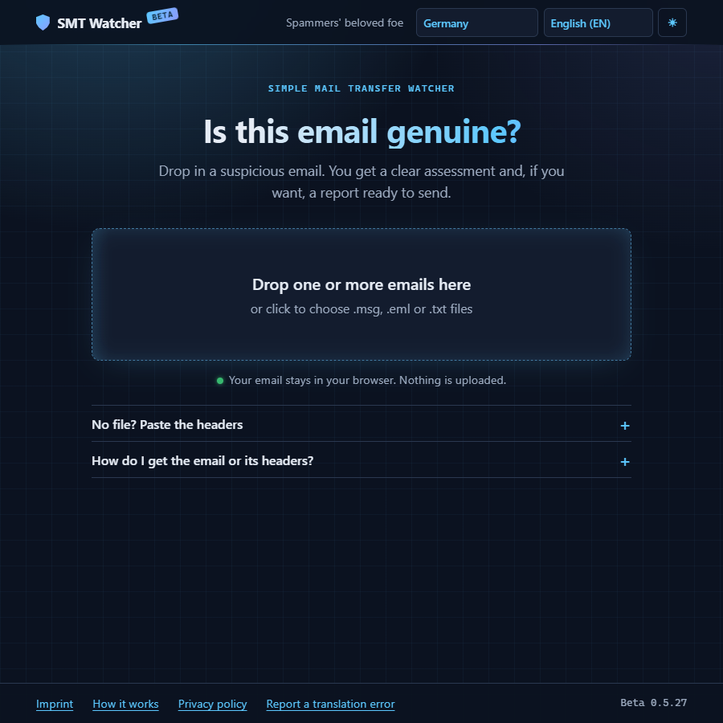
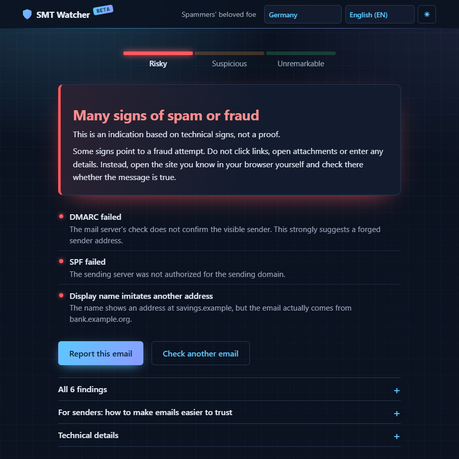
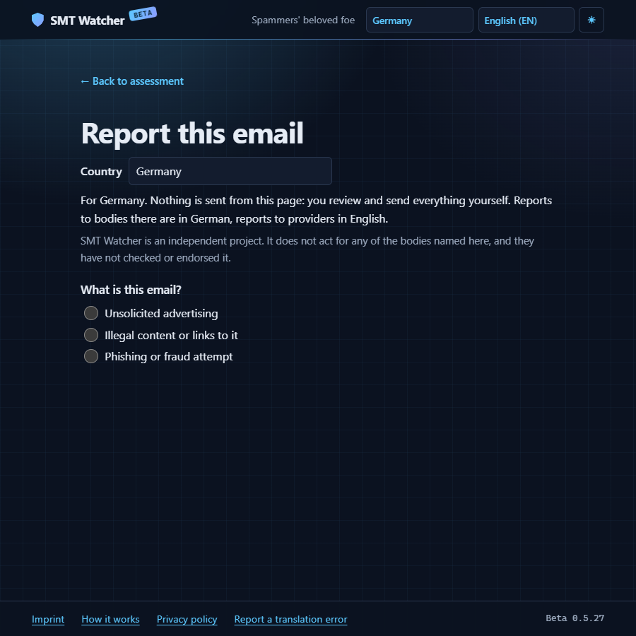

# SMT Watcher

Analyzes a suspicious email locally in the browser, explains the signs it finds and prepares a report for the user to review and send.

Spam and phishing are hard to judge from an email program, and reporting them often means finding the right body and the right data first. SMT Watcher does both, for 59 countries and in 23 languages. In German it is called SMT Wächter.



## What it does

- Reads `.msg` and `.eml` files, or pasted headers or email source. Up to 200 emails at once give a list with the most signs first, which can be saved as CSV.
- Shows the delivery route and the SPF, DKIM and DMARC results recorded by the receiving server.
- Checks the text, links and attachments without loading anything from the email.
- Gives one of three levels with reasons. There is no percentage and no all-clear: "no signs found" does not make an email safe.
- Prepares reports to checked reporting bodies of the chosen country, such as the Bundesnetzagentur in Germany, and to the abuse contact of the sending network. Where no body is checked for a case, the page says so. The user reviews and sends every report.
- Gives senders a few short, general tips for emails that are easier to trust.
- Runs as a web page and as a Thunderbird extension that checks the open email. The extension is offered for download on the page, not in the Thunderbird catalog.

The levels were tuned on one recipient's emails and checked on public spam, phishing and mailing list collections. They are not yet measured on other people's emails. See the [roadmap](docs/roadmap.md#measurements).





The screenshots show a made-up test email.

## Privacy

- The email is read and analyzed in the browser, and neither it nor its text is uploaded. The page sets no cookies and only keeps the chosen language and theme in the browser.
- The content security policy only allows connections to the RDAP registries and the page's own server. After a click on the abuse contact lookup, the IP address of the sending server goes to the registries.
- Only after a click on "Send", a few details about the sender go to the sender database, as described in words right before the click. The normal build of `npm run deploy` leaves this feature out, and the live page uses `npm run deploy:senderdb`.
- Reports are never sent from the page: the user reviews and sends them. The Thunderbird extension only creates drafts and has no permission to send.
- Images and other content from the email are never loaded.

See the [privacy policy](https://smtw.pixel-heaven.net/privacy.html) and the [roadmap](docs/roadmap.md#4-sender-database) for the sender database.

## Commands

Before the first build, copy `.env.example` to `.env.local` and enter the operator's name, address and email address. They appear in the imprint, and the contact form sends to the address. For the Thunderbird extension and the seed script, also enter the address of your own copy of the page and an add-on ID of your own: the extension links to that page and sends reports and lookups to its server. Git ignores `.env.local`, and the build stops if a value is missing.

| Command | Purpose |
|---|---|
| `npm run dev` | Start the page at `http://localhost:5173` |
| `npm test` | Run all tests. Tests on real emails run only if the local mail folders exist, and print counts only |
| `npm run test:browser` | Build the page and test it in the installed Chrome |
| `npm run build` | Build the web page into `dist/` |
| `npm run test:browser:db` | Build the page with the sender database and run its browser tests |
| `npm run deploy` | Build the page and upload `dist/` over encrypted FTP. Needs `.deploy.env`, see `.deploy.env.example` |
| `npm run deploy:senderdb` | The same with the sender database on, as the live page uses. The server keeps the sender database as a SQLite file in its closed `private/` folder |
| `npm run build:thunderbird` | Build the extension into `dist-thunderbird/`. Load its `manifest.json` as a temporary add-on |
| `npm run check:thunderbird` | Report whether the extension changed since its last release |
| `npm run package:thunderbird` | Build the extension and write `public/thunderbird/` (XPI and `updates.json`) to test it. The deploy packages and uploads the extension by itself when it changed |

## Structure

| Path | Content |
|---|---|
| `src/core/` | Analysis without any interface code |
| `src/data/reportingBodies.ts` | Reporting bodies per country |
| `src/i18n.ts`, `src/i18n*.ts` | Interface texts: German and English in `i18n.ts`, and one file for each of the other 21 languages |
| `src/resultView.ts`, `src/reportView.ts` | Assessment and reporting views |
| `extensions/thunderbird/` | Thunderbird extension using the same core and views |
| `e2e/` | Browser tests of the built page |
| `docs/roadmap.md` | Current state and next steps |
| `CHANGELOG.md` | Changes per version. The version itself is set in `package.json` |
| `docs/reporting-channels.md` | Checked reporting channels and their sources |
| `CONTRIBUTING.md`, `cla/` | How to contribute, and the Harmony contributor license agreements |
| `SECURITY.md` | How to report security problems privately |

`SpamMails/` and `LegitimeMails/` are local folders for real test emails. Git ignores them, and they must never be committed.

## Hosting your own copy

The page itself is static and runs on any web server. The sender database and the contact form need PHP 8.1 or later with the PDO SQLite driver (`pdo_sqlite`), which most hosts offer. No separate database server is needed.

- `npm run deploy:senderdb` uploads the page and switches the database on. On the first report or lookup, PHP creates the database file `private/smtw.sqlite` with its tables, and the keys `private/secret.php` and `private/day-key.php`. PHP must be allowed to write to `private/`.
- **`private/` must be closed to the web.** It holds the database, the keys and the settings. On Apache, the included `public/private/.htaccess` does this (`Require all denied`), as long as the host allows `.htaccess` files. Other web servers ignore that file, so close the folder in their own settings, for example on nginx:

  ```nginx
  location ^~ /private/ { deny all; }
  ```

  After each upload, `scripts/deploy.mjs` checks that `private/`, the database, the keys and the settings at `VITE_SITE_URL` answer 403 or 404, and fails if any of them answers otherwise or cannot be reached.
- A backup is a copy of `private/smtw.sqlite`, taken over FTP while nobody reports. Keep `private/secret.php` with it: without that key, the stored hashes no longer match any domain.
- The public `.htaccess` also redirects to https and sets security headers. On other web servers, set the same headers yourself.

## License

Copyright (C) 2026 Marc Trinklein, [pixel-heaven.net](https://pixel-heaven.net)

SMT Watcher is free software: you can redistribute and change it under the terms of the GNU Affero General Public License, version 3, see [LICENSE](LICENSE). It comes without any warranty. For other license terms, use the contact form in the [imprint](https://smtw.pixel-heaven.net/imprint.html).
